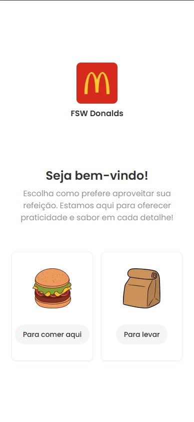
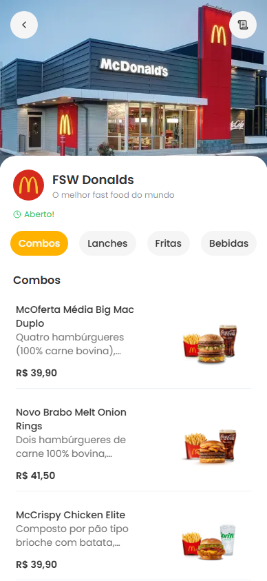
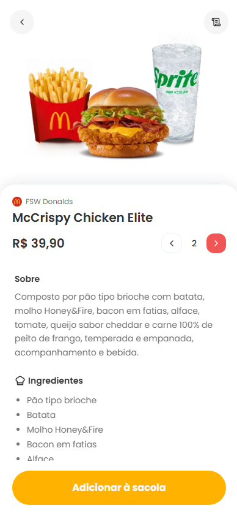
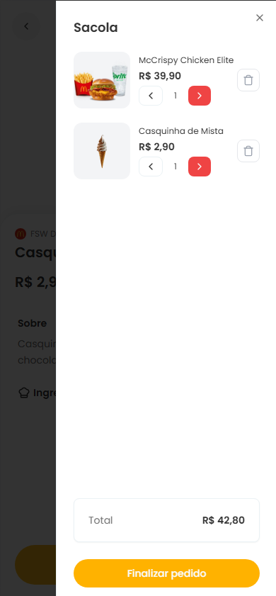
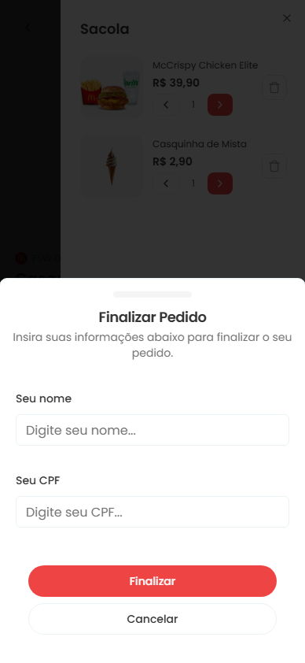
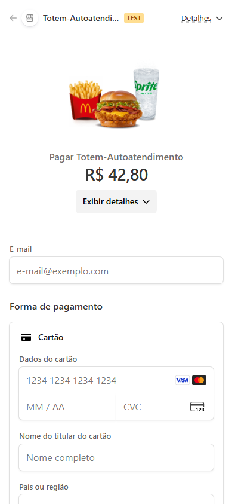
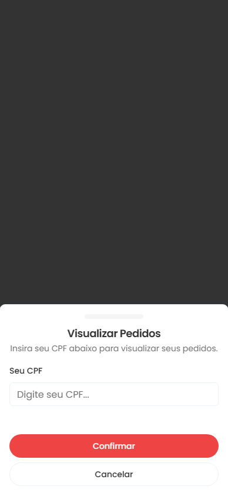
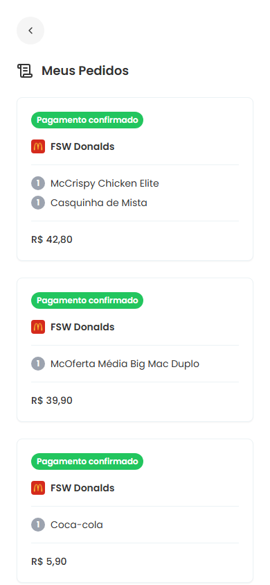
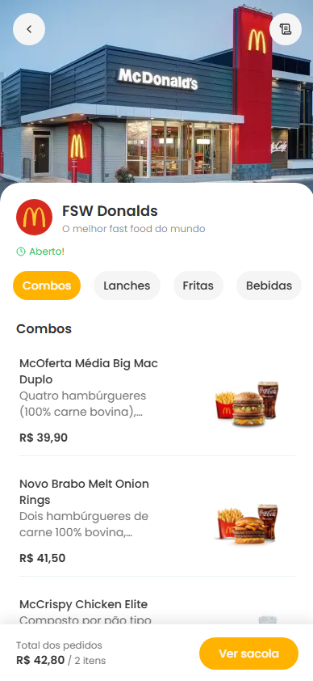
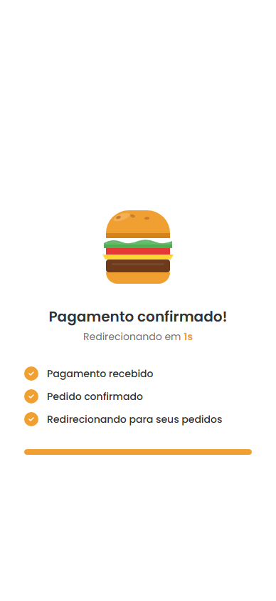

# Totem de Autoatendimento

Sistema de autoatendimento para restaurantes, no formato de totem. O cliente escolhe se vai comer no local ou levar, navega pelo cardápio, monta o pedido e paga com cartão via Stripe, sem passar por um atendente. O status do pedido é atualizado automaticamente quando o Stripe confirma ou encerra o pagamento.

A demonstração usa o restaurante fictício **FSW Donalds**.

**Deploy:** [totem-autoatendimento.vercel.app/fsw-donalds](https://totem-autoatendimento.vercel.app/fsw-donalds)

## Sumário

- [Screenshots](#screenshots)
- [Funcionalidades](#funcionalidades)
- [Stack](#stack)
- [Arquitetura](#arquitetura)
- [Modelo de dados](#modelo-de-dados)
- [Fluxo de pagamento](#fluxo-de-pagamento)
- [Como rodar localmente](#como-rodar-localmente)
- [Deploy](#deploy)
- [Scripts e testes](#scripts-e-testes)
- [Limitações conhecidas](#limitações-conhecidas)
- [Autor e licença](#autor-e-licença)

## Screenshots

| Boas-vindas | Cardápio | Detalhes do produto |
|---|---|---|
|  |  |  |

| Sacola | Finalizar pedido | Checkout Stripe |
|---|---|---|
|  |  |  |

| Consulta por CPF | Meus pedidos | Cardápio por categoria |
|---|---|---|
|  |  |  |

| Tela pós-pagamento |
|---|
|  |

## Funcionalidades

- **Entrada por restaurante.** Cada restaurante tem sua própria URL (`/{slug}`). Na entrada, o cliente escolhe entre comer no local e levar.
- **Cardápio por categorias**, com página de detalhes, descrição e ingredientes de cada produto.
- **Sacola** com ajuste de quantidade, remoção de itens e total sempre visível. Cada restaurante tem a sua.
- **Checkout com Stripe.** Nome e CPF são validados, e os valores são sempre calculados no servidor a partir do banco.
- **Atualização automática de status** via webhook: pagamento confirmado ou pagamento não concluído.
- **Histórico de pedidos por CPF**, com status, itens e total de cada pedido.
- **Tela pós-pagamento** que remove a página do Stripe do histórico do navegador.

## Stack

| Tecnologia | Papel |
|---|---|
| Next.js 16 (App Router) | Rotas, Server Components, Server Actions e Route Handlers |
| React 19 e TypeScript | Interface e tipagem estática |
| PostgreSQL e Prisma | Banco de dados relacional, migrations e seed |
| Stripe | Checkout Session hospedado e webhooks de pagamento |
| Tailwind CSS e shadcn/ui | Estilização e componentes acessíveis |
| React Hook Form e Zod | Formulários e validação, com o mesmo schema no cliente e no servidor |
| react-number-format | Máscara de CPF |

## Arquitetura

A aplicação é um único projeto Next.js, sem backend separado. Cada peça tem um papel definido:

| Peça | Local | Papel |
|---|---|---|
| Server Components | `src/app/**/page.tsx` | Buscam os dados no banco e renderizam no servidor |
| Client Components | arquivos com `"use client"` | Usados só onde há interação: carrinho, quantidades, formulários e animações |
| Server Action | `src/app/[slug]/menu/actions/create-order.ts` | Valida o pedido, grava no banco e cria a sessão de checkout no Stripe |
| Route Handler | `src/app/api/webhooks/stripe/route.ts` | Recebe o webhook do Stripe e atualiza o status do pedido |

### Estrutura de pastas

```
src/
├── app/                              # rotas (App Router)
│   ├── layout.tsx                    # layout raiz: fonte e Toaster
│   ├── api/webhooks/stripe/route.ts  # webhook do Stripe
│   └── [slug]/                       # tudo o que pertence a um restaurante
│       ├── layout.tsx                # CartProvider: um carrinho por restaurante
│       ├── contexts/cart.tsx         # estado do carrinho (React Context)
│       ├── page.tsx                  # boas-vindas e escolha do método de consumo
│       ├── menu/
│       │   ├── page.tsx              # cardápio por categoria
│       │   ├── [productId]/          # detalhes do produto
│       │   ├── actions/create-order.ts
│       │   └── components/           # categorias, produtos, sacola e finalização
│       ├── success/page.tsx          # tela pós-pagamento
│       └── orders/                   # histórico de pedidos por CPF
├── components/ui/                    # componentes shadcn/ui
├── data/                             # consultas reutilizadas em mais de um lugar
├── helpers/                          # funções puras: CPF, moeda e centavos
└── lib/                              # clientes de infraestrutura: Prisma, Stripe e cn()
prisma/                               # schema, migrations e seed
public/                               # imagens estáticas e screenshots
tests/                                # testes com node:test
```

O código fica junto da rota que o usa. Só sai de `src/app/` o que é compartilhado entre rotas, seguindo três regras:

- **`helpers/`** guarda funções puras, sem I/O, que podem rodar no cliente e no servidor: `isValidCpf`, `cpfSchema`, `formatCurrency` e `toCents`.
- **`lib/`** guarda um cliente por serviço externo, criado num único lugar: `db` (Prisma) e `getStripe()`, que concentra a chave e a versão da API do Stripe.
- **`data/`** guarda só as consultas usadas em mais de um lugar. Hoje é `getRestaurantBySlug`, usada pela página do restaurante e pela Server Action. Uma consulta usada por uma página só fica na própria página.

### Decisões de projeto

- **Um carrinho por restaurante.** O `CartProvider` fica em `src/app/[slug]/layout.tsx`, e não no layout raiz. O Next remonta esse layout quando o `slug` muda. Assim o carrinho continua entre o cardápio e os pedidos do mesmo restaurante, mas nunca passa para outro.
- **Uma única regra de CPF.** Os formulários e a Server Action usam o mesmo `cpfSchema`. O que o formulário aceita é exatamente o que o servidor aceita.
- **Status alterado só pelo webhook.** A página `/success` não marca nada como pago. Quem confirma o pagamento é o evento assinado do Stripe.

## Modelo de dados

```
Restaurant (slug único)
  ├── MenuCategory[]
  │     └── Product[]
  ├── Product[]
  └── Order[]
        ├── OrderProduct[] → Product   (quantidade e preço no momento da compra)
        ├── customerName, customerCpf  (CPF armazenado só com dígitos)
        ├── status: PENDING | IN_PREPARATION | PAYMENT_CONFIRMED | PAYMENT_FAILED | FINISHED
        └── consumptionMethod: DINE_IN | TAKEAWAY
```

O `OrderProduct` guarda o preço do momento da compra. Alterar o preço de um produto não muda pedidos antigos.

## Fluxo de pagamento

```
Cliente informa nome e CPF e confirma o pedido
    ↓
Server Action createOrder()
  1. valida a entrada (Zod)
  2. busca os preços no banco, apenas deste restaurante
  3. salva o pedido com status PENDING
  4. cria a sessão de checkout no Stripe com os mesmos preços
  5. devolve a URL da sessão
    ↓
Navegador é redirecionado para o checkout do Stripe
    ↓
Pagamento concluído                      Sessão expirada (padrão: 24h)
checkout.session.completed               checkout.session.expired
PENDING → PAYMENT_CONFIRMED              PENDING → PAYMENT_FAILED
    ↓
Stripe redireciona para /{slug}/success
    ↓
router.replace() para /{slug}/orders
```

### Garantias da criação do pedido

Uma Server Action é um endpoint público: qualquer cliente pode chamá-la com qualquer conteúdo. Por isso `createOrder` não confia em nada que vem do navegador:

- **Entrada validada com Zod.** O nome não pode ser vazio, o CPF precisa ser válido, deve haver pelo menos um produto, cada quantidade deve ser inteira e maior ou igual a 1, e `consumptionMethod` deve ser `DINE_IN` ou `TAKEAWAY`.
- **Preços sempre do banco.** O carrinho envia apenas `id` e `quantity`. O total gravado e os itens cobrados no Stripe vêm das mesmas linhas do banco, então o valor pago é sempre o valor do pedido.
- **Produtos do restaurante correto.** A consulta filtra por `restaurantId`. Um produto desconhecido ou de outro restaurante cancela a operação antes de qualquer gravação.
- **Valores em centavos inteiros.** `toCents()` arredonda `preço × 100`, porque o Stripe recusa valores fracionados (por exemplo, `36.2 × 100 = 3620.0000000000005`).
- **Stripe validado antes de gravar.** `getStripe()` é chamado no início, então a falta da chave nunca deixa um pedido órfão no banco.

Se algo falhar, o formulário exibe uma mensagem de erro e o botão volta a ficar disponível.

### Webhook

Rota: `POST /api/webhooks/stripe`.

| Evento | Novo status |
|---|---|
| `checkout.session.completed` | `PAYMENT_CONFIRMED` |
| `checkout.session.expired` | `PAYMENT_FAILED` |

- **Assinatura obrigatória.** Uma requisição sem assinatura ou com assinatura inválida recebe `400`, e nada é alterado.
- **Transição apenas a partir de `PENDING`.** O Stripe não garante a ordem de entrega dos eventos. O update usa `where: { id, status: "PENDING" }`, então um evento atrasado nunca desfaz um pagamento confirmado.
- **Identificação do pedido** pela metadata `orderId` da sessão, gravada em `createOrder`.

O evento `charge.failed` não é usado. Ele carrega a metadata da cobrança, não a da sessão, e um cartão recusado dentro do checkout ainda pode ser trocado e pago. O `checkout.session.expired` só ocorre quando o cliente de fato não pagou.

### Página `/success`

O `success_url` aponta para `/{slug}/success`, e não diretamente para a lista de pedidos. A página exibe uma animação e redireciona com `router.replace()`, que remove o checkout do Stripe do histórico do navegador. Sem isso, o gesto de voltar no iOS e o botão voltar do Android levariam o cliente à tela de sessão expirada do Stripe.

## Como rodar localmente

### Pré-requisitos

- Node.js 22.18 ou superior. O `npm test` executa TypeScript diretamente no Node.
- npm
- PostgreSQL, local ou em nuvem
- Conta no Stripe. O modo de teste é suficiente.

### Instalação

```bash
git clone https://github.com/RobotEby/totem-de-autoatendimento.git
cd totem-de-autoatendimento
npm install                 # também executa prisma generate
cp .env.example .env        # preencha as variáveis abaixo
npx prisma migrate dev      # cria as tabelas
npx prisma db seed          # cria o restaurante "fsw-donalds" com o cardápio
npm run dev
```

A aplicação fica disponível em `http://localhost:3000/fsw-donalds`.

### Variáveis de ambiente

| Variável | Descrição |
|---|---|
| `DATABASE_URL` | String de conexão do PostgreSQL |
| `STRIPE_SECRET_KEY` | Chave secreta do Stripe (Developers, API keys) |
| `STRIPE_WEBHOOK_SECRET_KEY` | Segredo de assinatura do webhook, fornecido pelo Stripe CLI (local) ou pelo painel (produção) |

As três variáveis são usadas apenas no servidor. O navegador não precisa de nenhuma chave do Stripe, porque o redirecionamento usa a URL devolvida pela sessão.

### Webhook em ambiente local

Sem o webhook, os pedidos permanecem em `PENDING`. Instale o [Stripe CLI](https://stripe.com/docs/stripe-cli) e execute:

```bash
stripe listen --forward-to localhost:3000/api/webhooks/stripe
```

Copie o valor `whsec_...` exibido no terminal para `STRIPE_WEBHOOK_SECRET_KEY` e reinicie o servidor. Para pagar, use o cartão de teste `4242 4242 4242 4242`, com qualquer data futura e qualquer CVC.

## Deploy

O projeto roda na Vercel sem configuração adicional. O script `postinstall` gera o Prisma Client durante o build.

1. Cadastre `DATABASE_URL`, `STRIPE_SECRET_KEY` e `STRIPE_WEBHOOK_SECRET_KEY` nas variáveis de ambiente do projeto.
2. No painel do Stripe (Developers, Webhooks), crie um endpoint para `https://<seu-domínio>/api/webhooks/stripe`.
3. Assine os eventos `checkout.session.completed` e `checkout.session.expired`.
4. Copie o *signing secret* do endpoint para `STRIPE_WEBHOOK_SECRET_KEY`.

## Scripts e testes

| Script | Descrição |
|---|---|
| `npm run dev` | Servidor de desenvolvimento |
| `npm run build` | Build de produção, com checagem de tipos |
| `npm start` | Servidor de produção, após o build |
| `npm run lint` | ESLint em todo o projeto, incluindo a ordem dos imports |
| `npm test` | Testes com o executor nativo `node:test` |
| `npx prisma studio` | Interface para consultar e editar o banco |
| `npx prisma db seed` | Recria os dados de demonstração (apaga os restaurantes existentes) |

Os testes ficam em `tests/` e não exigem nenhuma dependência extra. Eles cobrem a lógica em que um erro custa mais:

- **Validação de CPF:** dígitos verificadores, CPFs com todos os dígitos iguais e tamanho incorreto.
- **Normalização de CPF:** apenas os dígitos são armazenados e consultados.
- **Conversão para centavos:** todo preço do seed precisa resultar em um número inteiro de centavos. Um produto novo no seed passa a ser coberto automaticamente.

## Limitações conhecidas

Pontos identificados e ainda não resolvidos, em ordem de importância:

1. **O histórico de pedidos é protegido apenas pelo CPF.** Quem conhece o CPF de alguém consegue ver os pedidos dessa pessoa, e o CPF aparece na URL e no histórico do navegador. Num totem compartilhado, o próximo cliente pode ver essas informações. O comportamento é aceitável para uma demonstração. Com clientes reais, sujeitos à LGPD, o ideal é exibir apenas o pedido da sessão (`success_url` com `{CHECKOUT_SESSION_ID}`) ou exigir também o número do pedido.
2. **Valores monetários armazenados como `Float`.** A interface arredonda os valores e o Stripe recebe centavos inteiros, mas somas no banco podem conter frações de centavo (por exemplo, `108.60000000000001`). A solução definitiva é armazenar centavos em `Int`, o que exige uma migration.
3. **Pedido órfão em caso de falha do Stripe.** Se a criação da sessão falhar depois que o pedido for gravado, ele permanece em `PENDING` sem uma sessão que possa expirar.
4. **A tela `/success` informa "Pagamento confirmado!"** antes da chegada do webhook. O status real é exibido no histórico de pedidos.
5. **Dependências quase sem uso.** `@stripe/stripe-js` não é mais importado, e `next-themes` só serve para o Toaster ler um tema que nunca é definido. Para removê-las, execute `npm uninstall @stripe/stripe-js next-themes` e passe `theme="light"` em `src/components/ui/sonner.tsx`.

## Autor e licença

Desenvolvido por **RobotEby**.

- LinkedIn: [kerlon-amaral-dev](https://www.linkedin.com/in/kerlon-amaral-dev/)
- GitHub: [@RobotEby](https://github.com/RobotEby)

Distribuído sob a licença MIT. Consulte o arquivo [LICENSE](./LICENSE) para mais detalhes.

Copyright © 2026 **RobotEby**
